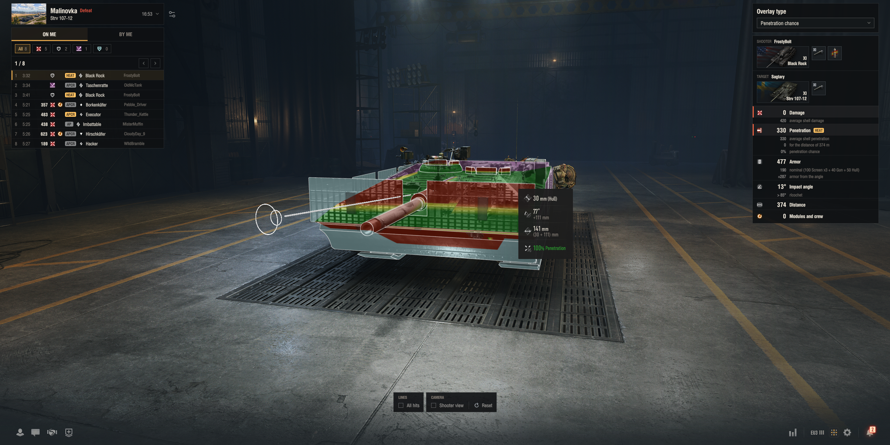
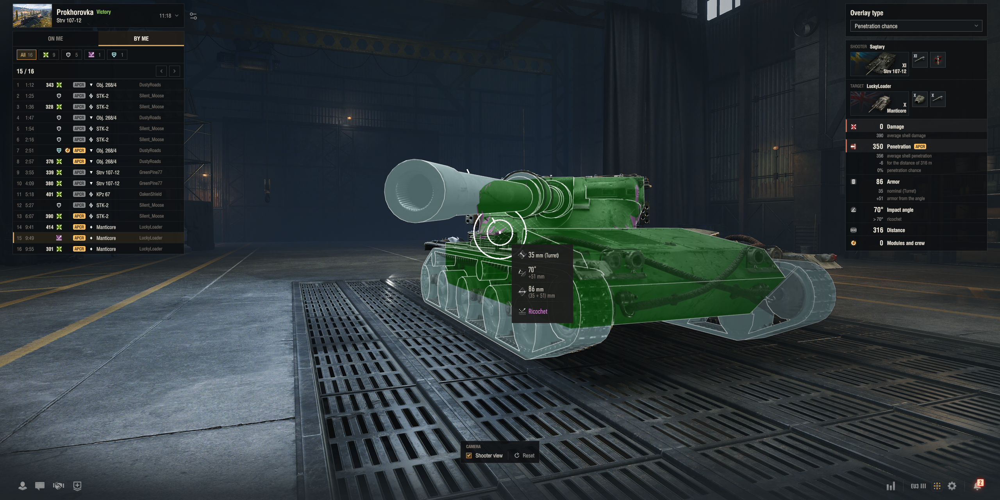
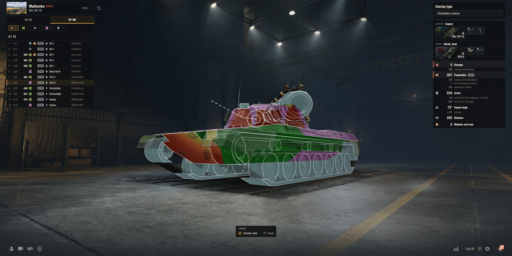
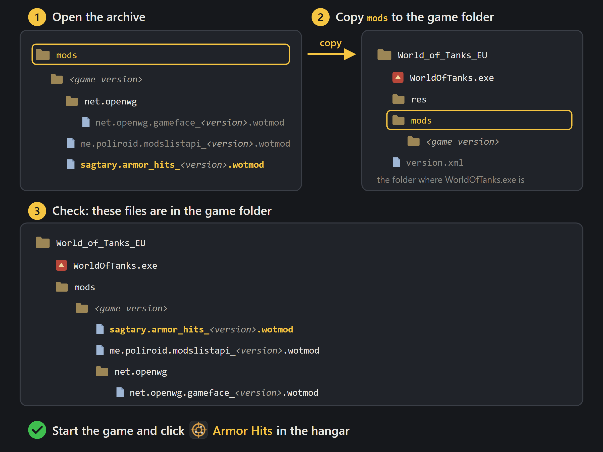

# Armor Hits by Sagtary

See every hit of your battles on your tank in the hangar: where you were hit, where your shells went, and why.



<p>
  
  
</p>

## Features

- **On me / By me**: hits you received and dealt, filtered by damage, blocked, ricochet, no damage.
- **3D way of the shell** on the tank, turret and gun turned as at the moment of the hit.
- **Shooter view**: the camera looks along the shell.
- **Details**: damage, penetration, armor, impact angle, distance, damaged modules and crew.
- **Game's armor views** and armor tooltip for the shell of the hit.
- **Battles kept** for the session or on disk, by mode: Random, Competitive, Training, Fun and events, Other.

## Installation



Without the archive: install [OpenWG Gameface](https://gitlab.com/openwg/wot.gameface) and
[ModsList API](https://gitlab.com/wot-public-mods/mods-list), then copy `sagtary.armor_hits_<version>.wotmod` into
`[WoT game directory]/mods/2.4.1.0/`.

## Requirements

- World of Tanks EU 2.4.1.0
- [OpenWG Gameface](https://gitlab.com/openwg/wot.gameface) and
  [ModsList API](https://gitlab.com/wot-public-mods/mods-list), included in the archive

## FAQ

**My last battle is not in the list.** Its mode is set to **Off** in **Keep battles** (the gear next to the battle
list). By default only Random and Competitive battles are kept.

**No Armor Hits button.** Check that the files are in the folders shown in the installation picture.

## Report a bug

[Create an issue](https://github.com/pavel-bolhovitin/wot-armor-hits/issues/new/choose) and pick **Bug report** or
**Idea**. No GitHub account? Write in the comments on WGMods.

## For developers

```text
C:\Python27\python.exe build.py            # build/sagtary.armor_hits_<version>.wotmod
C:\Python27\python.exe build.py --install  # also copy it into the game; WOT_DIR sets the game folder
```

Code layout: [docs/architecture.md](docs/architecture.md). License: [MIT](LICENSE).
